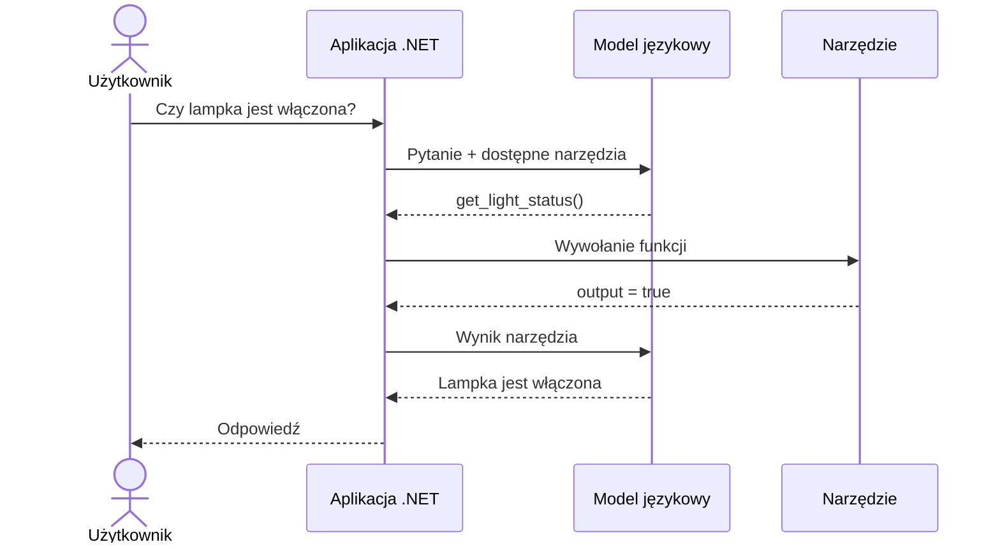
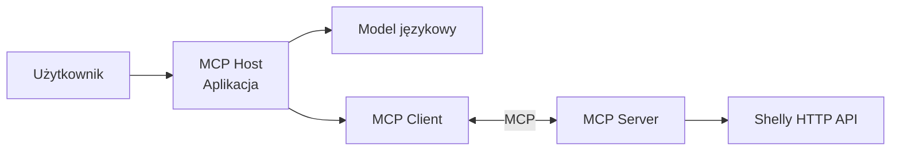

# Tworzenie agentów AI w .NET

## Wykład 03 — Tool Calling i MCP

### Jak udostępnić modelowi językowemu narzędzia?

---

**Marcin Sulecki**  
marcin.sulecki@pw.edu.pl

## Cel wykładu

Model językowy potrafi generować odpowiedzi, ale sam w sobie nie ma dostępu do aktualnego stanu urządzeń, baz danych ani systemów zewnętrznych.

Podczas wykładu zobaczymy, jak rozszerzyć jego możliwości za pomocą **Tool Calling** oraz jak udostępniać narzędzia przez **Model Context Protocol (MCP)**.

Poznamy:

1. **Tool Calling** — jak model wybiera funkcje i przekazuje ich argumenty?
2. **Function Invocation** — kto faktycznie wykonuje funkcje wskazane przez model?
3. **MCP** — jak udostępniać narzędzia niezależnie od konkretnej aplikacji?
4. **MCP Inspector** — jak testować narzędzia bez udziału modelu językowego?
5. **Bezpieczeństwo** — jak kontrolować działania wykonywane za pośrednictwem modelu?

## 1. LLM bez narzędzi

Zacznijmy od pytania:

> Czy lampka w moim pokoju jest teraz włączona?

Model nie zna odpowiedzi, ponieważ nie ma dostępu do urządzenia.

Może jednak odpowiedzieć na to pytanie, jeśli aplikacja udostępni mu odpowiednie narzędzie.

**Kluczowa myśl:** model nie musi posiadać wszystkich informacji. Musi wiedzieć, jak uzyskać te, których potrzebuje.

## 2. Tool Calling

Tool Calling pozwala modelowi wskazać funkcję, którą aplikacja powinna wykonać, oraz przekazać jej argumenty.

Przykładowe narzędzia:

- `turn_on_light` — włączenie lampki,
- `turn_off_light` — wyłączenie lampki,
- `get_light_status` — odczyt aktualnego stanu.

### Jak działa Tool Calling?

1. Użytkownik wydaje polecenie.
2. Model wybiera narzędzie i określa argumenty.
3. Aplikacja wykonuje wskazaną funkcję.
4. Wynik trafia z powrotem do modelu.
5. Model formułuje odpowiedź lub wybiera kolejne działanie.



> **Model nie wykonuje funkcji samodzielnie. Wybiera narzędzie, a aplikacja odpowiada za jego wykonanie.**

## 3. Demonstracja — Shelly

Wykorzystamy inteligentne gniazdko **Shelly Plug S Gen3** z podłączoną lampką.

Przykładowe polecenia:

> Włącz lampkę.

> Wyłącz lampkę.

> Czy lampka jest teraz włączona?

Porównamy bezpośrednie wywołanie HTTP API z wykorzystaniem Tool Calling.

**Pytanie:** co się stanie, jeśli model nie otrzyma narzędzia pozwalającego odczytać stan lampki?

## 4. Problem integracji

Wyobraźmy sobie system korzystający z wielu zewnętrznych usług:

- bazy danych,
- kalendarza,
- systemu plików,
- urządzeń IoT,
- wewnętrznych API.

Każda aplikacja mogłaby implementować własny sposób udostępniania tych narzędzi.

Jak umożliwić ich ponowne wykorzystanie przez różnych klientów?

## 5. Model Context Protocol (MCP)

**MCP** to otwarty protokół umożliwiający aplikacjom udostępnianie narzędzi, zasobów i szablonów promptów w ustandaryzowany sposób.

### Architektura MCP

Podstawowe elementy:

| Element | Rola |
|---|---|
| MCP Host | Aplikacja zarządzająca połączeniami z serwerami MCP. |
| MCP Client | Komponent komunikujący się z konkretnym serwerem MCP. |
| MCP Server | Udostępnia narzędzia i inne możliwości przez protokół MCP. |



Serwer MCP może udostępniać narzędzia bez bezpośredniego połączenia z modelem językowym.

## 6. MCP Inspector

**MCP Inspector** umożliwia:

- połączenie z serwerem MCP,
- odkrywanie dostępnych narzędzi,
- sprawdzanie ich argumentów,
- ręczne wywoływanie narzędzi,
- analizowanie odpowiedzi serwera.

Uruchomienie:

```bash
npx @modelcontextprotocol/inspector
```

**Pytanie:** skoro MCP Inspector potrafi wywoływać narzędzia bez modelu językowego, to jaka jest rola LLM w aplikacji korzystającej z MCP?

## 7. Tool Calling a MCP

| Tool Calling | MCP |
|---|---|
| Mechanizm wyboru narzędzi przez model. | Protokół udostępniania narzędzi klientom. |
| Model wskazuje funkcję i argumenty. | Klient odkrywa dostępne narzędzia i ich schematy. |
| Aplikacja wykonuje wskazaną operację. | Serwer MCP obsługuje wywołania narzędzi. |
| Nie wymaga MCP. | Nie wymaga LLM. |

**Tool Calling i MCP nie konkurują ze sobą — mogą współpracować.**

Przykładowy scenariusz:

1. Klient MCP pobiera listę narzędzi z serwera.
2. Aplikacja udostępnia odkryte narzędzia modelowi.
3. Model wybiera odpowiednie narzędzie.
4. Klient MCP przekazuje wywołanie do serwera.
5. Serwer wykonuje operację.
6. Wynik trafia z powrotem do modelu.

## 8. Ograniczenia i bezpieczeństwo

Udostępnienie narzędzia modelowi nie oznacza, że każde jego wywołanie powinno zostać automatycznie zaakceptowane.

Warto rozważyć:

- kontrolę uprawnień,
- walidację argumentów,
- potwierdzanie operacji o istotnych skutkach,
- obsługę błędów,
- rejestrowanie wywołań narzędzi.

**Pytanie:** czy pozwolilibyśmy modelowi bez potwierdzenia wykonać przelew bankowy albo usunąć wszystkie pliki?

## Podsumowanie

Po wykładzie powinieneś rozumieć:

1. Dlaczego modele językowe potrzebują narzędzi.
2. Jak działa Tool Calling.
3. Dlaczego model nie wykonuje narzędzi bezpośrednio.
4. Jaki problem rozwiązuje MCP.
5. Czym różnią się MCP Host, Client i Server.
6. Jak Tool Calling i MCP współpracują ze sobą.

### Najważniejsze wnioski

> **Tool Calling pozwala modelowi wybierać narzędzia.**
>
> **MCP pozwala aplikacjom udostępniać i odkrywać narzędzia.**

## Materiały

- [OpenAI — Function Calling](https://platform.openai.com/docs/guides/function-calling)
- [Model Context Protocol — dokumentacja](https://modelcontextprotocol.io/)
- [MCP Inspector](https://github.com/modelcontextprotocol/inspector)
- [Shelly Plug S Gen3 — API](https://shelly-api-docs.shelly.cloud/gen2/Devices/Gen3/ShellyPlugSG3)
- [Shelly Switch API](https://shelly-api-docs.shelly.cloud/gen2/ComponentsAndServices/Switch)

## Laboratorium

Praktyczne wykorzystanie tych mechanizmów omówimy podczas
[Laboratorium 04 — Tool Calling](../../labs/04-tool-calling/README.md) i [Laboratorium 05 — MCP](../../labs/05-mcp/README.md).

## Na kolejnym wykładzie

### Code Execution — co zrobić, gdy nie mamy gotowego narzędzia?

Model potrafi już korzystać z przygotowanych funkcji.

A co, jeśli potrzebuje wykonać operację, której programista wcześniej nie przewidział?

Na kolejnym wykładzie zobaczymy, jak model może **generować i wykonywać kod**, a także jakie problemy bezpieczeństwa wiążą się z takim rozwiązaniem.